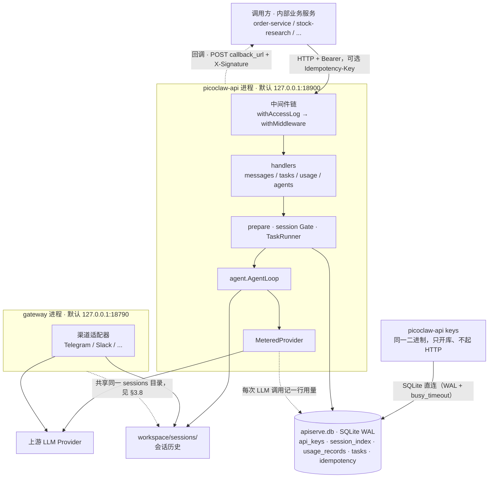
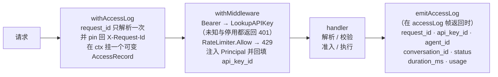
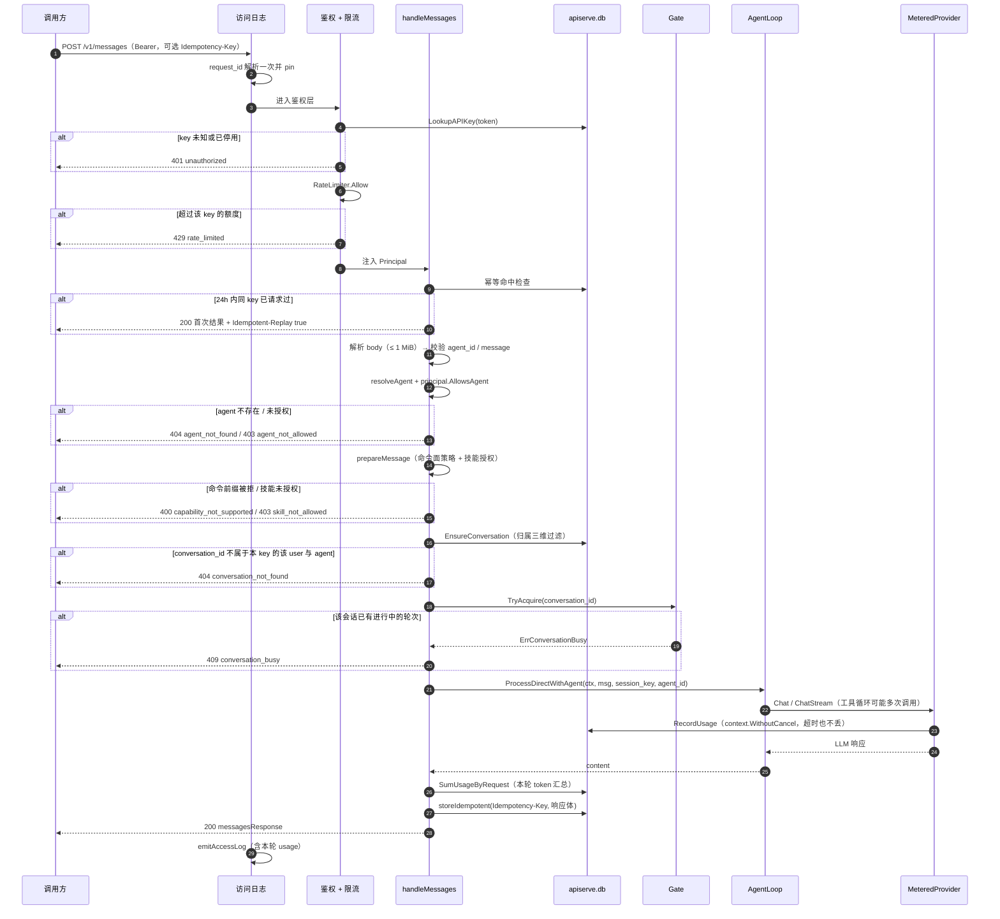
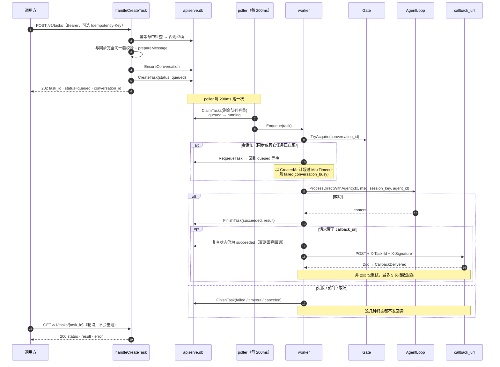
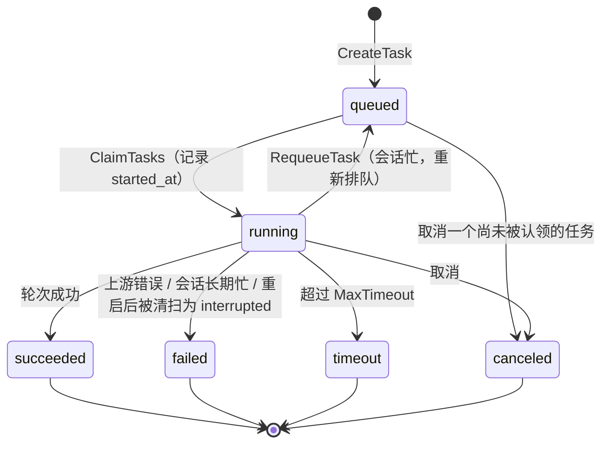
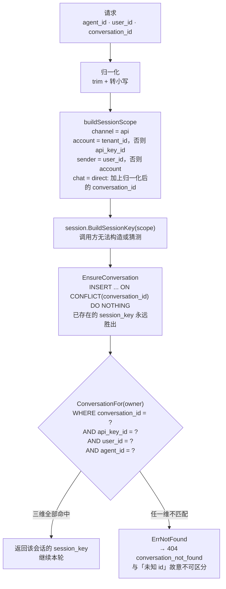

# picoclaw-api

把 PicoClaw 的 Agent 以 HTTP 接口暴露给**其他业务服务**调用。调用方发一条消息，直接拿到 Agent 的回复（同步），或提交一个任务、轮询取结果（异步，成功时会额外回调一次）。

- 入口：`cmd/picoclaw-api`（服务）+ `pkg/apiserve`（实现）
- 定位：**内部业务服务之间**，可信内网。轻量 API Key 即可，不面向外部开放平台
- 监听：默认 `127.0.0.1:18900`，**不复用** gateway 的 `18790`
- 与 gateway 的关系：**两个独立进程**，可以同时跑在同一个 `PICOCLAW_HOME` 下

> 本文只描述当前已实现的行为。文末列了**尚未实现**的东西，请勿按未实现的语义编码。

---

## 架构与流程

### 组件与部署



要点：

- **两个进程、两个端口、一个 home**。接入层不写 PID 文件，gateway 写 `.picoclaw.pid`。
- **CLI 与服务共用 `apiserve.db` 但不共用进程**：WAL + `busy_timeout` 让 `keys` 子命令可以在服务运行时执行。
- **`AgentLoop` 是复用的上游组件**，接入层只注入一个计量过的 provider 和一个显式指定 Agent 的入口。

### 请求中间件链

`/v1/*` 的每个请求都按下面的顺序穿过固定三层（`router.go`）：



- 顺序是**负载相关**的：`withAccessLog` 必须在最外层，否则 `withMiddleware` 回填 `api_key_id` 时记录还不存在。
- `AccessRecord` 是**挂在 context 上的指针**，里层的 handler 与鉴权层直接原地改它；单纯用 `r.WithContext` 传值无法把信息传回外层帧。
- `/health` 与 `/ready` **不经过这一链**，也不进访问日志。
- 未匹配的 `/v1/*` 路径与 405 **绕过敏捷读日志链**，返回纯文本（见 §3.9）。

### 同步请求（`POST /v1/messages`）



### 异步任务与回调（`POST /v1/tasks`）



要点：

- **`202` 只表示入队成功**，与是否成功执行无关。
- **poller 是唯一认领 `queued` 的地方**，且它从数据库认领，所以重启后遗留的任务会被接上。
- **`CallbackURL` 为空时没有任何回调**；带回调时也只有 `succeeded` 会发。
- 取消是**尽力而为**：`POST .../cancel` 会先尝试打断进行中的轮次，再写终态。

### 任务状态机



**首个终态获胜**：`FinishTask` 与 `MarkTaskCanceled` 都带 `WHERE status IN (queued, running)` 守卫，所以取消之后到达的"完成"写入会变成空操作——这正是"取消后回调被跳过"的原因（回调前会复查状态）。

`callback_status` 与任务状态**相互独立**：`pending → delivered | failed`。回调失败**不改**任务状态。

### 会话键与归属隔离



三个设计要点，都值得单独注意：

1. **归属判定在 SQL 里，不在 handler 里**。所以任何现在或未来的读取路径都不可能绕过它。
2. **`agent_id` 也是归属的一部分**。会话键的 scope 里烘焙了 agent，把 A 的会话交给 B 会"用 A 的会话键执行在 B 上"。
3. **会话键由服务端签发且落库**。调用方只能持有一个不透明 id，无法通过构造参数换到别人的 `session_key`。

---

## 1. 快速开始

### 1.1 准备配置

服务复用 PicoClaw 的 `config.json`（默认 `<home>/config.json`）。它至少要包含一个可用模型：

```json
{
  "model_list": [
    { "model_name": "test", "model": "openai/gpt-4o", "api_key": "sk-..." }
  ],
  "agents": {
    "defaults": { "model_name": "test" },
    "list": [ { "id": "main", "default": true } ]
  }
}
```

少了 `model_list` 或 `agents.defaults.model_name`，服务**根本起不来**：

```
Error: create provider: model "" not found in model_list: model is required
```

两个容易踩的坑：

- **`config.json` 不能带 BOM**（Windows 上用 `Set-Content -Encoding UTF8` 默认会写 BOM）。带 BOM 会被拒绝：`invalid character 'ï' looking for beginning of value`。
- **配置里出现未知字段会让整份配置加载失败**，并报出精确路径（例如 `unknown field "api"`）。这是 PicoClaw 的有意设计，不是本服务的限制。

`agents.list[*]` 的 `id` 就是下面接口里的 `agent_id`。

### 1.2 签发一个 API Key

```bash
# 明文只在这一刻打印一次，请立刻存进你的密钥管理
./picoclaw-api keys create --home /srv/picoclaw --name order-service \
    --allowed-agents main,stock --rate-limit "20/s,8"
```

输出：

```
id:        key_25dc2b6fb46d89af4a906285
name:      order-service
api_key:   pk_live_1138fc81bcdad26175608f5fa5c5193076108e2a0bb8cc62ba13701d24d6ec10
note: this plaintext is shown once and cannot be retrieved again
```

### 1.3 启动服务

```bash
./picoclaw-api --home /srv/picoclaw                 # 127.0.0.1:18900
./picoclaw-api --home /srv/picoclaw --host 0.0.0.0   # 提供给内网其他主机
./picoclaw-api --home /srv/picoclaw --port 18901     # 换端口
```

| 参数 | 说明 |
|---|---|
| `--home` | PicoClaw home。默认取 `PICOCLAW_HOME`，再退回用户目录 |
| `--config` | `config.json` 路径。默认取 `PICOCLAW_CONFIG`，否则 `<home>/config.json` |
| `--host` | 绑定地址，默认 `127.0.0.1` |
| `--port` | 绑定端口，默认 `18900` |
| `--debug` | 打开 debug 日志 |

> **`--config` 的作用**：加载模型与 Agent 定义。服务读的是 `model_list`、`agents.list[*]`、`agents.defaults.*`、`tools.*`、`mcp.*`、`hooks.*`；它**不读** `channels.*`，也不读 `gateway.host/port`。日志级别目前借用 `gateway.log_level`。

### 1.4 发一次同步调用

```bash
curl -sS http://127.0.0.1:18900/v1/messages \
  -H "Authorization: Bearer pk_live_1138fc81..." \
  -H "Content-Type: application/json" \
  -d '{"agent_id":"main","message":"帮我总结这份财报"}'
```

```json
{
  "conversation_id": "conv_7f3a91c2",
  "message_id": "msg_f8fc5d2468c2f895",
  "agent_id": "main",
  "content": "……",
  "session_key": "sk_v1_...",
  "usage": { "input_tokens": 1234, "output_tokens": 567, "cost": 0 },
  "duration_ms": 8432
}
```

---

## 2. 接口

统一前缀 `/v1`，JSON，鉴权用 `Authorization: Bearer <api_key>`。

| 方法 | 路径 | 说明 |
|---|---|---|
| `GET` | `/health` | 进程存活。**无需鉴权**，不依赖模型 |
| `GET` | `/ready` | 已绑定监听且就绪。**无需鉴权** |
| `GET` | `/v1/agents` | 当前 key 可用的 `agent_id` 列表 |
| `POST` | `/v1/messages` | **同步**：一轮对话，阻塞到拿到完整回复 |
| `POST` | `/v1/tasks` | **异步**：入队，返回 `task_id` |
| `GET` | `/v1/tasks/{task_id}` | 查询任务状态与结果（幂等，不会重跑） |
| `POST` | `/v1/tasks/{task_id}/cancel` | 尽力而为地取消 |
| `GET` | `/v1/usage` | 用量聚合（只含本 key 的数据） |

### 2.1 请求字段（`POST /v1/messages` 与 `POST /v1/tasks` 共用）

| 字段 | 必填 | 说明 |
|---|---|---|
| `agent_id` | ✅ | `agents.list` 里的 id。大小写与首尾空格会被归一化 |
| `message` | ✅ | 用户消息文本。**见下面的命令前缀约束** |
| `conversation_id` | | 多轮上下文。不传则服务端生成一个，并在响应里返回。**下一轮务必带上同一个值** |
| `user_id` | | 调用方自己的用户标识。用于会话隔离；不传时按该 API Key 归并 |
| `skill` | | 本轮临时激活的技能名。一次只能一个。`"auto"` 表示让 Agent 语义挑选 |
| `skills` | ❌ | **P0 未支持**，传了返回 `400 capability_not_supported` |
| `tools_allow` | ❌ | **P0 未支持**，同上 |
| `timeout_ms` | | 本轮超时。超服务端硬顶时按硬顶截断 |
| `callback_url` | | 任务**成功**时回调的地址（仅 `/v1/tasks` 有意义） |
| `metadata` | | 会被接收但不回显，**不要依赖它做回传** |

### 2.2 响应：`POST /v1/messages`（200）

| 字段 | 说明 |
|---|---|
| `conversation_id` | 本轮会话 id，下一轮带回来 |
| `message_id` | 本轮消息 id |
| `agent_id` | 实际处理的 Agent（已归一化） |
| `content` | Agent 的回复正文 |
| `session_key` | 服务端签发的会话键。**调用方无法构造**，仅供排查 |
| `usage.input_tokens` / `usage.output_tokens` | 本轮真实 token 用量（含工具循环内的多次调用之和） |
| `usage.cost` | **恒为 `0`** —— 当前无模型定价配置 |
| `duration_ms` | 服务端处理耗时 |

### 2.3 响应：`POST /v1/tasks`（202）

```json
{ "task_id": "task_9c1f...", "status": "queued", "conversation_id": "conv_7f3a91c2" }
```

### 2.4 响应：`GET /v1/tasks/{task_id}`（200）

```json
{
  "task_id": "task_9c1f...",
  "status": "succeeded",
  "conversation_id": "conv_7f3a91c2",
  "result": { "...与 /v1/messages 的响应体相同..." }
}
```

`status` 取值：`queued` → `running` → `succeeded` | `failed` | `canceled` | `timeout`。
失败时会出现 `error: {"code":..., "message":...}`。查询这个端点**不会重跑任务**。

### 2.5 响应：`GET /v1/usage`

```bash
curl -sS "http://127.0.0.1:18900/v1/usage?group_by=agent&from=2026-10-01&to=2026-10-09" \
  -H "Authorization: Bearer pk_live_..."
```

```json
{ "group_by": "agent", "rows": [ { "key": "main", "requests": 2, "prompt_tokens": 30, "completion_tokens": 10, "total_tokens": 40 } ] }
```

- `group_by`：`agent` | `api_key` | `user`；留空表示总计。其他值 → `400 invalid_request`
- `from` / `to`：epoch 秒或 RFC3339
- 结果**只含本 key 自己的数据**

### 2.6 错误响应

所有 `/v1/*` 的错误体固定为：

```json
{ "error": { "code": "agent_not_allowed", "message": "api key may not use stock", "request_id": "f8fc5d2468c2f895" } }
```

| HTTP | `code` | 触发条件 |
|---|---|---|
| 400 | `invalid_request` | JSON 非法、`agent_id`/`message` 缺失、`group_by` 不支持、`from`/`to` 非法 |
| 400 | `capability_not_supported` | 传了 `skills[]`/`tools_allow[]`；或 `message` 用了 `/use` 之外的命令前缀 |
| 401 | `unauthorized` | 缺 Bearer token、key 未知、key 已停用 |
| 403 | `agent_not_allowed` | 该 key 未被授权使用这个 `agent_id` |
| 403 | `skill_not_allowed` | 该 key 的 `allowed_skills` 不含请求的技能 |
| 404 | `agent_not_found` | `agent_id` 不存在 |
| 404 | `task_not_found` | `task_id` 不存在**或不属于本 key**（故意不可区分） |
| 409 | `conversation_busy` | 同一 `conversation_id` 已有进行中的同步轮次 |
| 413 | （`invalid_request`） | 请求体超过 1 MiB |
| 429 | `rate_limited` | 超过该 key 的 `rate_limit` |
| 500 | `internal_error` / `agent_error` | 服务端或上游模型故障 |
| 504 | `agent_timeout` | 超过 `timeout_ms` 或服务端硬顶 |

**每个响应都会带 `request_id`**（或回显你传的 `X-Request-Id`），排查时请一并提供。

---

## 3. 必须知道的约束

### 3.1 命令前缀：普通正文不要以 `/` 或 `!` 开头 ⚠️

Agent 内置了 13 个斜杠命令。为了避免 API 调用方误触它们，**除 `/use` 外任何命令前缀的消息都会被拒绝**：

```
/help 了解一下   → 400 capability_not_supported（"command /help is not available through the API"）
/useful 的东西   → 400（未知命令同样拒绝，不会交给 Agent）
!status          → 400（`!` 也是命令前缀）
```

**如果你的业务正文本身可能以 `/` 或 `!` 开头，请在调用前加一个前导空格或换一种表述。** 这是唯一一个会让人意外的硬约束。

`/use <技能名> <真正的问题>` 是唯一放行的命令，用于本轮临时激活技能——但更推荐用结构化字段 `"skill": "..."`，服务端会替你转换。

### 3.2 同一会话的并发：同步拒、异步等

同一 `conversation_id` 同时只允许一轮：

- **同步**：第二个请求立刻得到 `409 conversation_busy`
- **异步**：任务会被重新入队等待（以任务创建时间计，超过服务端硬顶则以 `conversation_busy` 失败），不会丢

不同 `conversation_id` 之间是并行的。

### 3.3 超时语义：504 表示"结果未知"

`timeout_ms` 到期后服务端返回 504，但**该轮可能已经写了一半会话、甚至已经执行过工具**。服务端**不承诺回滚**。

因此 504 的正确处理方式是：**不要直接重试**，先确认副作用（例如查业务侧状态或后续轮次的历史），再决定。

### 3.4 幂等

带上 `Idempotency-Key` 头即可：

```bash
curl -H "Idempotency-Key: order-8891-retry-1" ...
```

- 24 小时内同 key 重复请求，返回**首次的结果**，并带响应头 `Idempotent-Replay: true`
- 服务端**不会**重复调用 Agent
- **幂等空间按 API Key 隔离**：另一个 key 用了相同的头值，不会拿到你的结果

### 3.5 限流

按 API Key 计。在签发 key 时用 `--rate-limit` 指定：

| 写法 | 含义 |
|---|---|
| `20/s` | 每秒 20，突发容量 20 |
| `20/s,8` | 每秒 20，突发容量 8 |
| `600/min` | 每分钟 600（≈每秒 10），突发容量 10 |
| 留空 | 不限 |

超过则 `429 rate_limited`。

### 3.6 异步回调（仅成功时触发）

**回调只在任务成功时发送。** 失败、超时、取消、以及进程重启导致的中断**都不会**回调——这些终态必须靠轮询 `GET /v1/tasks/{task_id}` 发现。请把回调当作**成功通知**，而不是"任务已结束"的通知。

任务成功时，服务端向 `callback_url` 发一次 POST：

```http
POST <callback_url>
Content-Type: application/json
X-Task-Id: task_9c1f...
X-Signature: sha256=<hex>
```

```json
{ "task_id": "task_9c1f...", "status": "succeeded", "result": { "...与 /v1/messages 响应体相同..." } }
```

> 回调体里的 `status` 恒为 `"succeeded"`（因为只有成功才回调），你不需要为它分支。
> **没有** `X-Timestamp` 头，签名也不含时间戳——见下方"防重放"。

**验签**：`X-Signature` 是 `HMAC-SHA256`，**密钥是你的 API Key 明文的 `sha256`**（十六进制字符串）：

```python
import hashlib, hmac
key_hash = hashlib.sha256(api_key.encode()).hexdigest()
expected = "sha256=" + hmac.new(key_hash.encode(), raw_body, hashlib.sha256).hexdigest()
```

注意签名覆盖的是**原始请求体字节**，请先取原始 body 再验签，不要先解析再序列化。

> 服务端只存 key 的 sha256、不存明文，所以无法用明文签名——这是与早期设计稿的已知偏差，已定稿。

其他语义：

- 投递失败重试 **5 次**，指数退避；**非 2xx 也会重试**（含 4xx），所以回调端返回 4xx 不会让它停止重试
- **回调是尽力投递**（最多 5 次尝试后放弃），**不保证送达**；但结果永远可拉取——回调失败**不影响**任务状态，`GET /v1/tasks/{id}` 始终能拿到结果。回调请做成幂等
- 签名**不带时间戳、也不带 nonce**，因此回调可被重放。需要防重放请自己按 `X-Task-Id` 去重

### 3.7 进程重启：不重放、也不回调

进程重启时，`running` 且 `started_at` 早于 1 小时前的任务会被标记为 `failed`（`error.code = "interrupted"`）。**不会重放**——避免工具副作用被执行两次；也**不会回调**，只记服务端日志。这类任务只能靠轮询发现，请把它们当作"需要人工确认"。

### 3.8 会话不要跨入口混用 ⚠️

同一个 `conversation_id` **不要**同时经 gateway 的渠道（Telegram/Slack/…）与 API 访问：两者共享 `<workspace>/sessions/` 目录，而该路径在跨进程下**没有任何并发保护**。选定一个入口后不要混用。

### 3.9 其他

- 请求体上限 **1 MiB**
- `agent_id` 会被归一化（大小写、首尾空格），所以 `"  Stock-Research  "` 与 `"stock-research"` 等价
- 未匹配的 `/v1/*` 路径与 405 会返回纯文本 404/405，**不带**错误信封，也不进访问日志

---

## 4. API Key 管理

`keys` 子命令与 HTTP 服务是**同一个二进制**。它只开数据库、不启动 HTTP 服务，因此**可以在服务运行时执行**。

```bash
./picoclaw-api keys --help
```

| 子命令 | 参数 | 说明 |
|---|---|---|
| `create` | `--name`(必填) `--owner-type` `--tenant` `--allowed-agents` `--allowed-skills` `--rate-limit` | 建 key，**打印一次明文** |
| `list` | `--json` | 列出 key。**不输出明文，也不输出 key_hash** |
| `disable` | `--id`(必填) | 应急停用。生效即时，无需重启服务 |
| `enable` | `--id`(必填) | 重新启用 |
| `rotate` | `--id`(必填) | 建一个新 key（继承全部属性）并停用旧的，**打印新明文一次** |

`create`/`list`/`enable`/`disable`/`rotate` 都支持：

| 参数 | 说明 |
|---|---|
| `--home` | PicoClaw home，用于推导 `apiserve.db` |
| `--db` | 直接指定 `apiserve.db` 路径（覆盖 `--home`） |

**并发安全**：数据库启用了 WAL 与 `busy_timeout`，所以在服务运行时执行 `keys create` / `keys disable` 不会 `SQLITE_BUSY`——这是**应急停用 key** 的正确姿势。

**两条硬规则**：

1. 明文**只在** `create`/`rotate` 时打到 stdout 一次，不进日志、不落文件、不写库
2. `list`（含 `--json`）**绝不**输出明文或 `key_hash`。`key_hash` 同时是回调签名密钥，泄漏等价于允许伪造回调

**已知取舍**：没有 `key_prefix` 列，`list` 只能靠 `name` + `id` 辨认。轮换期间同名会有两行，用 `enabled` 与 `id` 区分。

停用 key（应急撤销）：

```bash
./picoclaw-api keys disable --home /srv/picoclaw --id key_25dc2b6f...
```

---

## 5. 完整示例

### 5.1 同步多轮

```bash
CONV=conv_7f3a91c2
curl -sS http://127.0.0.1:18900/v1/messages \
  -H "Authorization: Bearer $KEY" -H "Content-Type: application/json" \
  -d "{\"agent_id\":\"main\",\"message\":\"这份财报营收多少\",\"conversation_id\":\"$CONV\"}"

# 第二轮带上同一个 conversation_id，上下文延续
curl -sS http://127.0.0.1:18900/v1/messages \
  -H "Authorization: Bearer $KEY" -H "Content-Type: application/json" \
  -d "{\"agent_id\":\"main\",\"message\":\"和去年同期比呢\",\"conversation_id\":\"$CONV\"}"
```

### 5.2 临时激活一个技能

```bash
# 推荐：结构化字段
curl -sS http://127.0.0.1:18900/v1/messages \
  -H "Authorization: Bearer $KEY" -H "Content-Type: application/json" \
  -d '{"agent_id":"main","message":"帮我看看这条新闻","skill":"finance-news"}'

# 等价写法（服务端会转换）：message 直接写 /use
#   {"message":"/use finance-news 帮我看看这条新闻"}
```

技能必须能被该 Agent 解析到，且在该 key 的 `allowed_skills` 内（未设置 `--allowed-skills` 即不限制）。

**`skill` 的三种取值**：

| 取值 | 行为 |
|---|---|
| 省略 / `""` | 不激活任何技能，消息原样交给 Agent |
| `"finance-news"` | 服务端把消息转成 `/use finance-news <你的正文>`，**本轮**激活该技能 |
| `"auto"` | **不加任何前缀、原样透传**，由 PicoClaw 内建的语义加载决定（系统提示里始终带着该 Agent 的完整技能目录，模型自己决定是否加载 SKILL.md） |

> ⚠️ **安全注意**：`auto` 与省略都**不**受 `allowed_skills` 约束——它们不是技能名，所以服务端不做白名单比对；实际可用技能面退回**该 Agent 自己的技能目录**。也就是说 `allowed_skills` 是"拒绝显式点名"的闸门，**不是**"限制本轮能用哪些技能"的能力边界。若你需要严格限制某个 key 的能力，请调小该 Agent 的 `skills` 白名单（在 Agent 定义里），而不是只依赖 `allowed_skills`。

### 5.3 异步 + 轮询

```bash
TASK=$(curl -sS http://127.0.0.1:18900/v1/tasks \
  -H "Authorization: Bearer $KEY" -H "Content-Type: application/json" \
  -d '{"agent_id":"main","message":"生成本月对账单","callback_url":"https://your.svc/hook"}' \
  | sed -n 's/.*"task_id":"\([^"]*\)".*/\1/p')

curl -sS "http://127.0.0.1:18900/v1/tasks/$TASK" -H "Authorization: Bearer $KEY"
```

### 5.4 用量对账

```bash
curl -sS "http://127.0.0.1:18900/v1/usage?group_by=api_key" -H "Authorization: Bearer $KEY"
```

---

## 6. 开发与测试

```bash
# 构建（tags 是必须的）
go build -tags "goolm,stdjson" -o picoclaw-api ./cmd/picoclaw-api

# 测试
go test -tags "goolm,stdjson" ./pkg/apiserve/ ./cmd/picoclaw-api/

# 竞态检测：本机为 Windows 时不可用（tsan 链接失败），请在 Linux/CI 上跑
go test -race -tags "goolm,stdjson" ./pkg/apiserve/
```

代码结构：

| 文件 | 职责 |
|---|---|
| `main.go` | cobra 根命令、flag、信号处理 |
| `keys.go` | `keys` 子命令组 |
| `pkg/apiserve/server.go` | 装配（config → provider → AgentLoop → HTTP server）与生命周期 |
| `pkg/apiserve/router.go` | 路由注册；`/v1` 全部走访问日志 + 鉴权 |
| `pkg/apiserve/auth.go` | Bearer 鉴权、限流、principal 注入 |
| `pkg/apiserve/prepare.go` | 命令面策略 + 技能授权（本轮消息的准入） |
| `pkg/apiserve/session.go` | 会话键签发与会话级串行化 `Gate` |
| `pkg/apiserve/tasks.go` | 异步 worker 池、poller、回调投递 |
| `pkg/apiserve/store*.go` | SQLite：key / 会话 / 任务 / 用量 / 幂等 |
| `pkg/apiserve/meter.go` | LLM 用量计量包装 |

---

## 7. 尚未实现（勿依赖）

| 项 | 说明 |
|---|---|
| SSE 流式 | 无流式端点。只有同步阻塞与异步任务两种形态 |
| OpenAI 兼容层 | 无 `POST /v1/chat/completions`，不能直接用 OpenAI SDK 接入 |
| 显式会话管理 | 无 `GET`/`DELETE /v1/conversations/...`。目前只能靠 `conversation_id` 续轮，无法查询或清空历史 |
| `config.json` 的 `api.*` 键 | **不支持**。端口/host 只能靠 `--host`/`--port`（或库层面的 `Options.Settings`） |
| `usage.cost` | 恒为 `0`，无模型定价配置。请按 token 计费 |
| 在途并发上限 | 只有 QPS + burst，没有"同时最多 N 个请求"的闸门 |
| 多实例 | 同会话串行化是**进程内锁**，多实例部署下失效。横向扩容前必须换成分布式锁 |
| 计量覆盖 | 只覆盖注入的 provider。Agent 因 fallback/light/hook 切换模型的轮次**不会**被计入用量。规避方式：让各 Agent 的模型与 `agents.defaults.model_name` 保持一致 |

---

## 8. 与 gateway 并存

两个进程互不干扰，可以同时运行在同一个 home 下：

| | gateway | picoclaw-api |
|---|---|---|
| 默认端口 | `18790` | `18900` |
| PID 文件 | 写 `.picoclaw.pid` | **不写** |
| 数据库 | 不用 | `apiserve.db`（WAL） |

实测确认（`docs/apiserve-coexistence.md`）：两者同时运行时健康检查均正常，PID 不冲突，且服务运行时执行 `keys` 子命令不会 `SQLITE_BUSY`。

**唯一需要遵守的**是 §3.8 那条红线：不要用同一个 `conversation_id` 同时经渠道与 API 访问。
